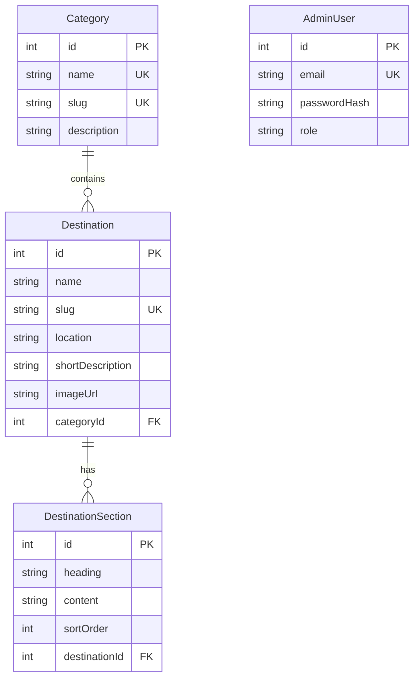

# Ceylon Trail

Ceylon Trail is a full-stack Sri Lankan travel guide. Visitors can browse destinations, search by name or location, filter by category, sort results, view details and save favourites. Administrators can log in and perform full persistent CRUD operations on destinations.

## Technology stack

- React, TypeScript, Vite and React Router
- Node.js, Express and TypeScript
- PostgreSQL with Prisma ORM
- Zod validation
- JWT-based administrator authentication

## Project structure

```text
serendib-frontend/   React user interface
serendib-backend/    Express API and Prisma database layer
```

## Setup

### 1. Install PostgreSQL

Create a PostgreSQL database named `serendib`.

### 2. Configure the backend

```bash
cd serendib-backend
cp .env.example .env
# Edit DATABASE_URL, JWT_SECRET, ADMIN_EMAIL and ADMIN_PASSWORD
npm ci
npx prisma generate
npx prisma migrate deploy
npm run seed
```

The seed command creates sample categories, destinations and the administrator account defined in `.env`.

### 3. Run the backend

```bash
cd serendib-backend
npm run dev
```

The API runs on `http://localhost:5000`.

### 4. Run the frontend

In another terminal:

```bash
cd serendib-frontend
npm ci
npm run dev
```

Open the Vite URL shown in the terminal. The Vite development proxy forwards `/api` requests to the backend.

Administrator login is available at `/admin/login`. Use the credentials from `.env`.

## CRUD API

| Method | Endpoint | Purpose | Authentication |
|---|---|---|---|
| GET | `/api/destinations` | List destinations | No |
| GET | `/api/destinations/:id` | View one destination | No |
| GET | `/api/categories` | List categories for filtering/forms | No |
| POST | `/api/destinations` | Create a destination | Admin JWT |
| PUT | `/api/destinations/:id` | Update a destination | Admin JWT |
| DELETE | `/api/destinations/:id` | Delete a destination | Admin JWT |
| POST | `/api/auth/login` | Log in an administrator | No |

Create and update requests are validated on the server using Zod. Duplicate slugs return HTTP 409, missing records return HTTP 404, invalid IDs return HTTP 400, and unauthorised CRUD requests return HTTP 401/403.

## Database design



`Category` to `Destination` is one-to-many. `Destination` to `DestinationSection` is one-to-many with cascading deletion. Destination slugs, category names, category slugs and administrator emails are unique.

## Build and verification

```bash
cd serendib-frontend && npm run build
cd ../serendib-backend && npm run build
```

Manual CRUD test sequence:

1. Log in at `/admin/login`.
2. Create a destination and verify it appears in the table.
3. Open the public home page and verify it appears in search, category filters and sorting.
4. Edit the destination and verify the updated content.
5. Delete it and confirm the browser confirmation dialog.
6. Verify the record is removed from both the admin list and public detail view.
7. Try an invalid slug, short description and duplicate slug to verify validation and error messages.

## Demonstration checklist

Keep the demonstration video below five minutes and keep the camera on. Show the public listing, search, filter, sort, details page, administrator login, create, update, validation error, confirmation before delete, successful delete, database schema and responsive layout.

## Academic integrity

This project should be submitted with the student's own explanation of design decisions and implementation. Keep meaningful commit history and be prepared to explain the CRUD routes, Prisma relationships, validation rules and authentication flow during the demonstration.
